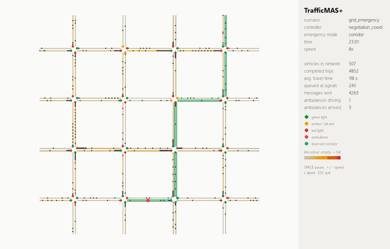
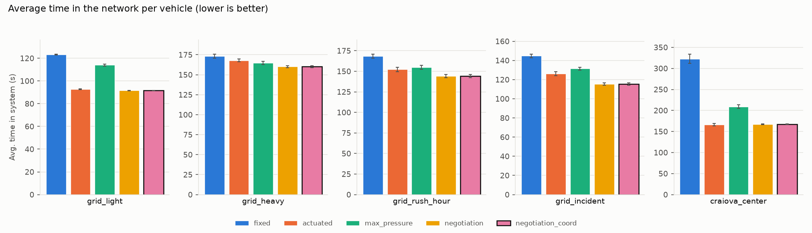
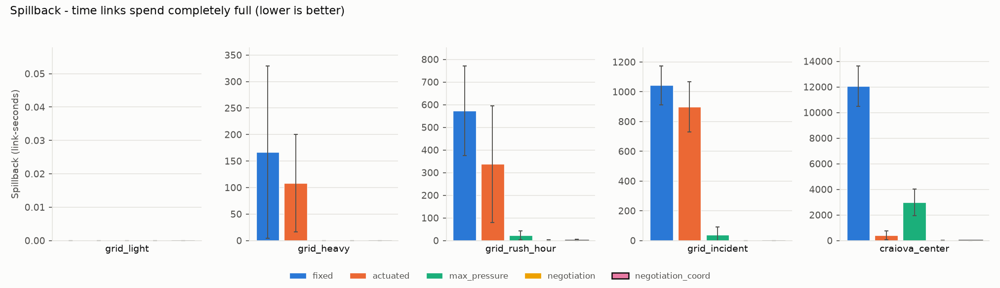
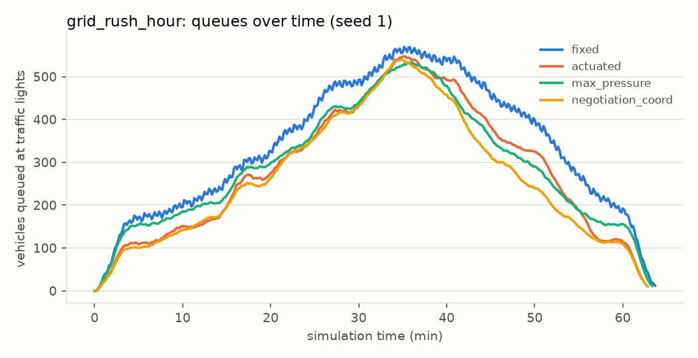
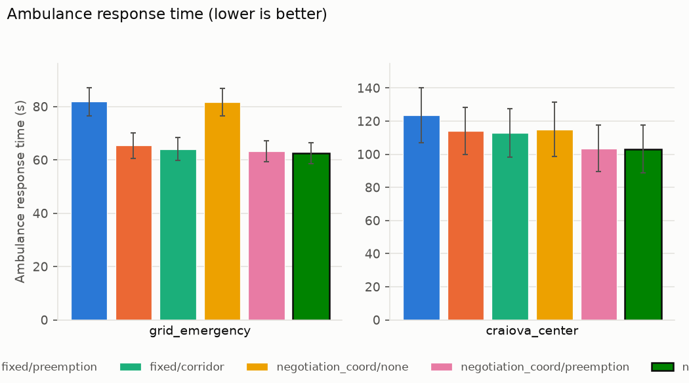
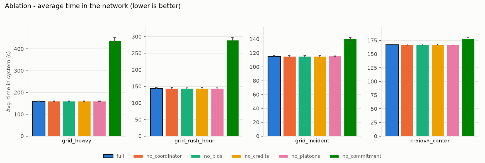
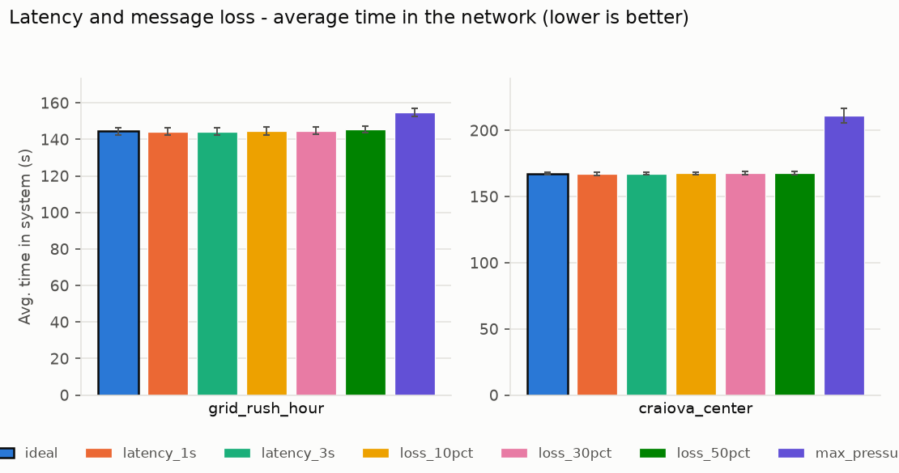
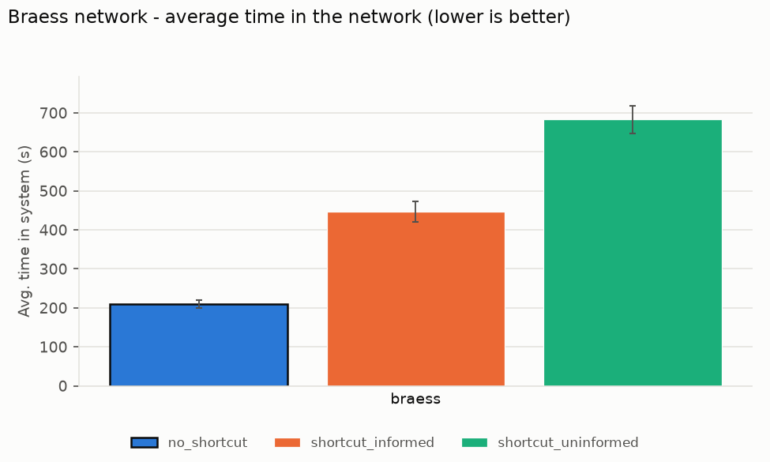
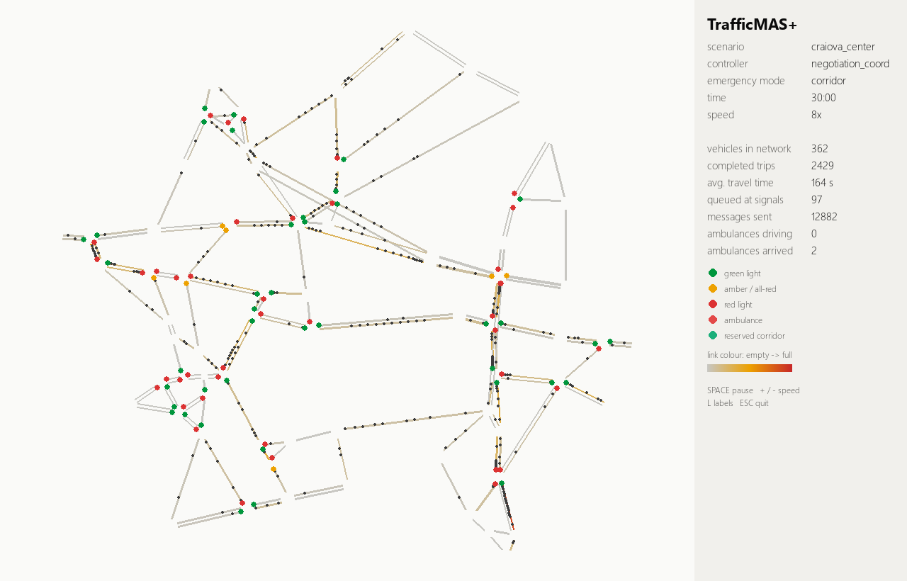

# TrafficMAS+

**Traffic lights that negotiate.** In this multi-agent traffic simulator every intersection is an autonomous agent. It controls its own lights and negotiates green time with its neighbours, so congestion does not spread from one junction to the next. Ambulances reserve a corridor of green lights ahead of them.

The project is written entirely in Python (SimPy, OSMnx/NetworkX for the map import, Pygame, Matplotlib, SciPy). It was built for the **Multi-Agent Systems** course (Master, year 2) by the team **GreenWave Agents**.



| | Member | Role | Code |
|---|---|---|---|
| 1 | IANCOVICI P.-A. TEODOR-GABRIEL | Simulation Core & Network Architect | `sim/`, `network/`, `bus/` |
| 2 | PRODAN F.-C. CONSTANTIN-IUSTIN | Intersection Control & Negotiation | `agents/intersection.py`, `agents/coordinator.py`, `control/` |
| 3 | GHEORGHEVICI F. MIHAI FLORIN | Vehicles, Routing & Emergency | `agents/vehicle.py`, `agents/emergency.py`, `routing/` |
| 4 | DOBRA C. ROBERT-CRISTIAN | Evaluation, Visualization & Experiments | `metrics/`, `viz/`, `experiments/` |

The project plan is in [docs/TrafficMAS_Planul_Proiectului.pdf](docs/TrafficMAS_Planul_Proiectului.pdf), in Romanian.

## Results

About 900 simulations, 10 seeds per configuration, each simulating one hour of traffic plus the time the network needs to empty. Numbers are means; the full tables with 95% confidence intervals and the tests are in `results/<experiment>/summary.md`. Every comparison uses a two-sided Mann-Whitney test with Holm correction; "significant" means p < 0.01.

### 1. Negotiation against the classic controllers

Average time a vehicle spends in the network, in seconds (the queue at the gateway included):

| scenario | fixed-time | actuated | max-pressure | **negotiation + coordinator** | vs. best baseline |
|---|---:|---:|---:|---:|---:|
| grid, off-peak | 123.3 | 92.8 | 114.0 | **91.6** | −1.3% (significant) |
| grid, saturated | 173.3 | 167.9 | 164.9 | **160.1** | −2.9% (significant) |
| grid, morning rush hour | 168.5 | 152.3 | 154.9 | **144.4** | −5.2% (significant) |
| grid, accident + closed street | 144.8 | 126.2 | 131.6 | **115.3** | −8.6% (significant) |
| Craiova city centre | 322.3 | **166.1** | 211.4 | 167.4 | +0.8% (not significant) |



**Spillback**, measured as the time links spend completely full, almost disappears:

| scenario | fixed-time | actuated | max-pressure | negotiation + coordinator |
|---|---:|---:|---:|---:|
| grid, rush hour | 573 | 338 | 23 | **2** |
| grid, accident | 1043 | 898 | 37 | **0** |
| Craiova | 12054 | 394 | 2983 | **11** |

In Craiova, actuated control is as fast on average as negotiation, but it lets links stay completely full about 35 times longer.



The queues over the morning rush hour show the same picture: negotiation drains the peak fastest.



**What it costs.** The negotiating junctions send 6–12 messages per agent per minute. The baselines send 5.6, all of them status reports and congestion broadcasts used for routing.

**Fairness** (Jain index of the waiting times per approach) is clearly better on the saturated grid: 0.82 against at most 0.75 for the baselines. It is slightly worse off-peak (0.93 vs. 0.96) and in the accident scenario (0.63 vs. 0.68 for max-pressure). The reason is that negotiation serves the busiest approaches first.

### 2. Ambulances

| | grid: response time (s) | grid: delay vs. free flow (s) | Craiova: response (s) | Craiova: delay (s) |
|---|---:|---:|---:|---:|
| negotiation, no priority | 81.7 | 24.4 | 114.9 | 20.3 |
| negotiation, local pre-emption | 63.3 | 6.2 | 103.5 | 9.2 |
| **negotiation, reserved corridor** | **62.4** | **5.1** | **103.2** | **8.6** |
| fixed-time, reserved corridor | 64.1 | 5.1 | 112.9 | 13.8 |

With a corridor, an ambulance loses 79% less time on the grid than without priority, and 58% less in Craiova. The corridor is slightly better than local pre-emption, but the difference between the two is not significant.

The clearer effect is on the **other vehicles**. Each run with ambulances is paired with the same run without them. Under fixed-time control, every ambulance with priority costs the rest of the traffic 5100–6200 vehicle-seconds on the grid. Under negotiation it costs 550–790, about 8× less, because the agents empty the queues that the ambulance left behind instead of going back to a fixed cycle. In Craiova this cost is too small to measure: all confidence intervals include zero.

In the conflict scenario, two ambulances reach junction n1_2 at the same moment. The one with the higher priority keeps its slot; the other is refused and re-plans its route.



### 3. Ablation: what each mechanism contributes

| removed mechanism | grid saturated | grid rush hour | grid accident | Craiova |
|---|---:|---:|---:|---:|
| none (full controller) | 160.1 | 144.4 | 115.3 | 167.4 |
| zone coordinator | 160.1 | 144.4 | 115.4 | 167.4 |
| Contract Net bids | 160.3 | 144.3 | 115.2 | 167.4 |
| credits | 160.1 | 144.4 | 115.3 | 167.4 |
| platoon messages | 160.3 | 144.5 | 115.8 | 167.5 |
| **commitment to the current phase** | **437.7** | **289.0** | **140.5** | **177.7** |

The result is unambiguous: **almost all of the gain comes from the BDI commitment** together with the pressure scoring. Without the commitment, the agents reconsider their phase every few seconds and lose a 4 s intergreen each time. Under saturation the grid then collapses into spillback.

The Contract Net, the credits, the coordinator and the platoons change the result by less than 0.5%, and none of these differences is significant. The reason is that they only act when a link is close to full, and the controller already keeps links from filling up: a whole hour of saturated traffic triggers only about 60 bids in the entire network. Raising the bid weight 4–8× changes nothing either.

So in these scenarios the negotiation layer is a safety net that is almost never needed. A network with much shorter links, where spillback cannot be avoided locally, would be needed to see it work.



### 4. Unreliable communication

Even 3 s of message latency or 50% of messages lost cost negotiation at most 0.8% on the rush hour (144.4 → 145.6 s). It still stays well ahead of max-pressure, which needs no messages at all (154.9 s). In Craiova the ambulance arrives 4 s later when half the messages are lost (103.2 → 107.2 s). The agents degrade gracefully because every one of them can always fall back on its local pressure.



### 5. A selfish junction

Junction n1_1 multiplies all of its bids by 5. Its share of the won bids rises from 31% to 35% with credits and to 36% without them. Waiting times, its own and everybody else's, do not change measurably. This is the same reason as in the ablation: bids almost never decide a phase in these scenarios. So the credit mechanism works as designed (the cheater cannot bid more than it can pay), but these scenarios cannot show that it matters.

### 6. Braess's paradox

| network | avg. time in the network |
|---|---:|
| without the shortcut A→B | 209 s |
| with the shortcut, drivers informed and selfish | 447 s (+114%) |
| with the shortcut, uninformed drivers on the free-flow shortest route | 683 s (+226%) |

Adding a road makes every driver slower. Selfish drivers who follow the congestion information lose less than drivers who all take the nominally shortest route, but both lose a lot compared to the network without the shortcut. This is the price of anarchy of selfish routing.



### The Craiova network in the live view



## Quick start

```bash
python -m venv .venv
.venv/Scripts/python -m pip install -e .[osm,dev]       # Linux/macOS: .venv/bin/python
.venv/Scripts/python -m trafficmas run scenarios/grid_rush_hour.yaml --controller negotiation_coord --live
```

Python 3.11 or newer is required. The live view uses `pygame-ce`, the maintained fork of Pygame, which has wheels for current Python versions.

| command | what it does |
|---|---|
| `python -m trafficmas run <scenario> -c <controller> [--live]` | one simulation; prints the metrics, `--live` opens the Pygame view |
| `python -m trafficmas compare <scenario> --seeds 3` | every controller on one scenario, averaged over seeds |
| `python -m trafficmas experiment experiments/main.yaml --docs docs` | a full experiment in parallel processes, then statistics and figures |
| `python -m trafficmas analyze results/main` | statistics and figures again from the saved runs |
| `python -m trafficmas list` | controllers, scenarios and experiments |
| `bash scripts/run_all_experiments.sh` | every experiment in this README: about 900 simulations, 10 minutes on 16 cores |

Options of `run`:
- `-p key=value` sets a controller parameter, e.g. `-p credits=false`;
- `-s key.path=value` overrides any scenario field, e.g. `-s demand.rate=9000` or `-s bus.loss=0.3`;
- `--record docs/demo.gif` saves the live view as a GIF without opening a window.

In the live view, `SPACE` pauses, `+`/`-` change the speed, `L` shows the node names and `ESC` quits.

**In VS Code**, open the folder and pick the `.venv` interpreter. The *Run and Debug* panel then has ready-made configurations: live view of the rush hour, the ambulance corridors and the Craiova network, comparing all controllers, the main experiment, and the tests. *Terminal → Run Task* has the same plus install, lint, all experiments, recording the GIF and re-downloading the OSM network.

## How the simulation works

```
          ┌──────────── Experiment runner: scenario × variant × seed, multiprocessing ────────────┐
          │                                                                                       │
 ┌────────▼────────┐     ┌──────────────────┐      ┌──────────────────────────────────────────┐
 │ SimPy engine    │◄───►│ Message bus      │◄────►│ IntersectionAgent  (one per junction)    │
 │ clock, demand,  │     │ latency, loss,   │      │ CoordinatorAgent   (one per zone)        │
 │ incidents       │     │ message counts   │      │ VehicleAgent / EmergencyVehicleAgent     │
 └────────┬────────┘     └──────────────────┘      └──────────────────────────────────────────┘
          │
 ┌────────▼────────┐     ┌──────────────────┐      ┌──────────────────┐
 │ Road network    │────►│ Metrics          │─────►│ Pygame live view │
 │ grid / OSM /    │     │ collector        │      │ Matplotlib plots │
 │ Braess          │     └──────────────────┘      └──────────────────┘
 └─────────────────┘
```

**Traffic model (mesoscopic).** A vehicle crosses a link at free-flow speed and joins a queue at the stop line. Each outgoing movement (left, through, right) has its own queue. A green movement discharges at saturation flow: 1800 veh/h per lane, shared by the lanes of the link. It can only do so while the downstream link has room left: a link holds `length × lanes / 7.5 m` vehicles. A full link blocks the junction behind it, which is how **spillback** spreads through a network. Every phase change costs a 4 s intergreen (amber + all-red). Vehicles from several approaches that merge into the same link are served first come, first served.

**Networks.**
- A parametric grid with arterial roads that have more lanes and a higher speed limit.
- The real centre of **Craiova**, around the University of Craiova, imported from OpenStreetMap with `scripts/fetch_osm.py`. It has 70 junctions, 154 links and 28.1 km of main roads (Calea Unirii, Bulevardul Carol I, Strada Alexandru Ioan Cuza, Pasajul Universității and others), with 53 junctions with traffic lights and 17 gateways on the border of the area.
- The classic **Braess** network.

**Demand.** Poisson arrivals between gateways, with a constant or rush-hour profile and an origin–destination matrix that can be biased (e.g. west→east in the morning). The demand of a seed is identical for every controller, so the controllers are compared on exactly the same traffic.

**Scenarios** (`scenarios/*.yaml`):

| scenario | network | traffic |
|---|---|---|
| `grid_light` | 4×4 grid | 6000 veh/h, off-peak |
| `grid_heavy` | 4×4 grid | 18000 veh/h, saturated |
| `grid_rush_hour` | 4×4 grid | 13000 veh/h at the peak, mostly west→east and south→north |
| `grid_incident` | 4×4 grid | 11000 veh/h; an accident blocks 75% of an arterial for 25 min and a side street is closed |
| `grid_emergency` | 4×4 grid | 14000 veh/h; 10 ambulances, two of them crossing at the same junction at the same time |
| `craiova_center` | Craiova city centre, OpenStreetMap | 5500 veh/h at the peak, 4 ambulances |
| `braess` | Braess network | 1600 veh/h from S to E, with or without the shortcut |

## The agents

The four agent types behave differently along the four properties of an agent (Wooldridge):

| agent | autonomy | reactivity | proactivity | social ability |
|---|---|---|---|---|
| **IntersectionAgent** | chooses its own phases | reacts to its queues, corridor requests and coordinator directives | bids for green downstream before its exits fill up; announces platoons | Contract Net with its neighbours, status reports to the coordinator |
| **VehicleAgent** | chooses its own route | re-plans on congestion broadcasts and closures | pursues its destination | listens to the coordinators' broadcasts |
| **EmergencyVehicleAgent** | plans its corridor | re-plans around a junction that refuses it | reserves junctions before it reaches them | FIPA Request for every slot, ETA updates, release |
| **CoordinatorAgent** | decides its zone's strategy | detects spillback | broadcasts congestion estimates | collects status, sends drain and meter directives |

Messages use FIPA-ACL performatives (`CFP`, `PROPOSE`, `ACCEPT`, `REJECT`, `REQUEST`, `INFORM`) and go over a bus that can delay and lose them. Every delivery is counted, which gives the communication cost of each controller. The shared interfaces of the four parts are in [`trafficmas/contracts.py`](trafficmas/contracts.py).

### The negotiating intersection (the original part)

[`control/negotiation.py`](trafficmas/control/negotiation.py) runs a simplified **BDI** loop:

- **Beliefs**: its own queues, how full the downstream links are, the bids of the current round, platoon notices from upstream and directives from the coordinator.
- **Desires**: low pressure, no spillback into the neighbours, serving the platoons that arrive.
- **Intention**: the current green phase. When a phase turns green the agent **commits** to it until the queue it found is served (at most 40 s). After that it switches only when another phase scores clearly better (hysteresis). Every switch costs an intergreen, so an agent that keeps reconsidering loses capacity exactly when traffic is heaviest. Without the commitment, the controller collapses under saturation (see the ablation).

Each phase gets a **score**:
- the max-pressure weight of its movements: queue minus the average queue downstream, zero into a full link;
- plus the vehicles about to arrive;
- plus the bids of the upstream neighbours;
- plus the platoons announced to it;
- plus or minus the coordinator's directives.

**Contract Net for green time.** Each agent is the manager of its own green time and a contractor for its downstream neighbours:

```
 upstream U (contractor)                          downstream N (manager)
        │   ◄────────── CFP (round r, link U→N) ──────────   │  only to neighbours whose link into N is > 50% full
        │   urgency = vehicles waiting at U to enter U→N     │
        │             × how full U→N is                      │
        │   ─────────── PROPOSE (value ≤ credits) ────────►  │  silent if not urgent (saves messages)
        │                                                    │  score(phase) += 0.4 × bids for its links
        │   ◄──── ACCEPT (pay value) / REJECT ─────────────  │  settled when the phase is decided
```

**Credits.** An accepted bid is paid with credits. Credits regenerate at 0.25 per second, up to 80. A junction that inflates its bids runs out of credits and cannot dominate its neighbours for long (see the manipulation test).

**Platoons.** When a green ends, the agent tells each signalised downstream neighbour how many vehicles it just released and when they will arrive. The neighbour adds them to the score of the phase that serves them. Green waves then emerge from local messages alone, without any central offset plan.

**Coordinator directives.** When a link is more than 85% full, the zone coordinator asks the junction at its end to drain it and the junction feeding it to hold traffic back (meter), for 30 s.

### Ambulances

Three modes are compared:
- `none`: no priority. The ambulance moves to the head of the queue, because cars pull aside, but waits for green. At a red light it crosses carefully after 8 s.
- `preemption`: classic local pre-emption. A junction switches to the ambulance's phase as soon as the ambulance is on its approach.
- `corridor`: at departure the ambulance sends a FIPA `REQUEST` for a time slot to every signalised junction on its route, with its ETA there.
  - Each junction starts the green early enough to empty the approach: an intergreen, plus the time to clear the queue, plus a margin.
  - On a crowded link the ambulance is slowed down by up to 2.5×, because cars have to get out of its way. So an empty approach pays off.
  - ETAs are refreshed while driving, and a slot is released as soon as the ambulance has crossed.
  - Two requests that need different phases at the same time are settled by priority: a higher priority displaces a lower one, which is told so and tries to re-plan around that junction.

### Vehicles

Vehicles route with a **time-dependent A\*** over links, so turn restrictions are respected. A link costs its free-flow time plus the queueing delay last broadcast by the coordinators. That delay fades out over a horizon (10 min by default), since a queue seen now matters less to a vehicle that will arrive there much later.

There are three driver profiles: conservative, normal and aggressive. A driver follows the advice with probability 0.2 / 0.5 / 0.9 and switches route for a gain of at least 30% / 15% / 5%. Drivers who do not follow the advice take their usual free-flow route.

## Tests

```bash
.venv/Scripts/python -m pytest -q        # 46 tests, about 10 s
.venv/Scripts/ruff check trafficmas tests scripts
```

The tests cover:
- the network builders (phases, turns, storage, the OSM import);
- the bus (latency, loss, zone broadcasts);
- routing (closures, congestion, the time-dependent delay, no U-turns);
- every controller, the commitment and starvation guard, and a full Contract Net round with payment;
- the credit cap on a selfish bidder, and corridor conflicts settled by priority;
- end-to-end runs of every controller, determinism per seed, ambulances in every mode, closures, and the OSM and Braess scenarios.

CI (GitHub Actions) runs the tests and the linter on Linux and Windows, plus a short experiment and a headless recording of the live view.

## Project layout

```
trafficmas/
  contracts.py            messages, agent and controller interfaces shared by the four parts
  sim/  engine.py demand.py                         (1) SimPy world, demand, incidents
  network/  road.py grid.py osm.py braess.py        (1) queue model and network builders
  bus/  bus.py                                      (1) message bus with latency and loss
  agents/  intersection.py coordinator.py           (2) signal agents and zone coordinators
  control/  classic.py negotiation.py               (2) fixed, actuated, max-pressure, negotiation
  agents/  vehicle.py emergency.py                  (3) drivers and ambulances
  routing/  router.py                               (3) time-dependent A*, congestion board
  metrics/  collector.py                            (4) trip records, samples, CO2, fairness
  viz/  live.py plots.py                            (4) Pygame view, figures
  experiments/  runner.py analysis.py               (4) parallel runs, statistics
scenarios/        YAML scenarios
experiments/      YAML experiment definitions
results/<name>/   runs.csv (one row per run) and summary.md (tables and tests)
data/             Craiova road network exported from OpenStreetMap (© OpenStreetMap contributors, ODbL)
scripts/          fetch_osm.py, run_all_experiments.sh
docs/             figures, demo GIF, project plan
```

## Limitations

- The traffic model is mesoscopic, not microscopic. There is no car following or lane changing, and a queue's length counts vehicles, not metres of road. This keeps a one-hour simulation of a city district at a few seconds, which made the roughly 900 runs of the experiments possible.
- Left turns do not yield to oncoming traffic, there are no pedestrians, and right turns on red are not allowed.
- CO2 is a simple estimate (150 g/km driving, 0.5 g/s idling, 10 g per stop), meant only to compare controllers with each other.
- The baselines were tuned on the grid with two seeds outside the evaluation seeds:
  - fixed-time: 30 s greens;
  - actuated: 8–30 s greens with a 3 s gap;
  - max-pressure: a decision every 20 s, which was much better than 8 s under saturation.
  The negotiation parameters were tuned the same way.
- The optional reinforcement-learning baseline from the plan was not implemented.
