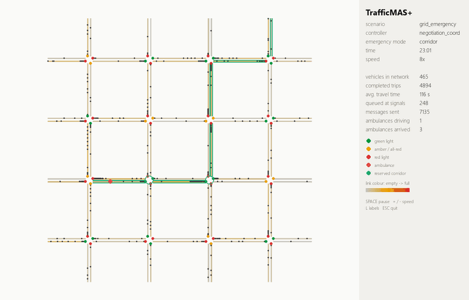
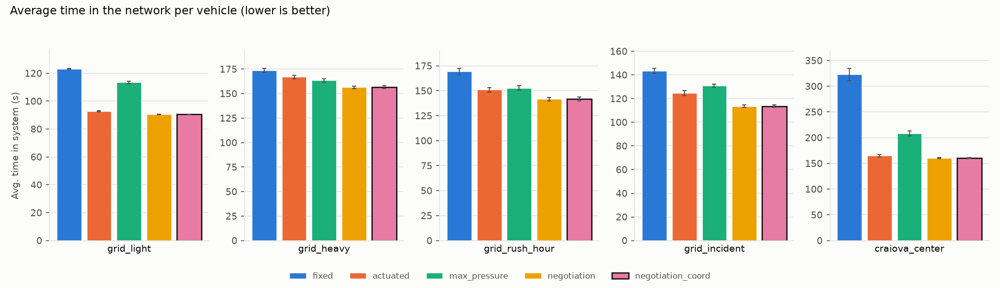
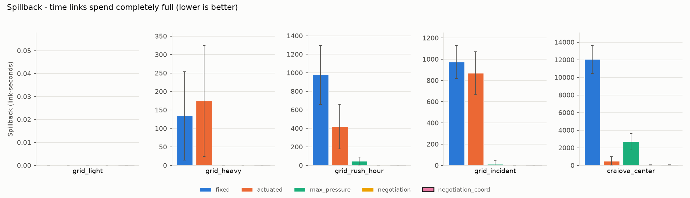
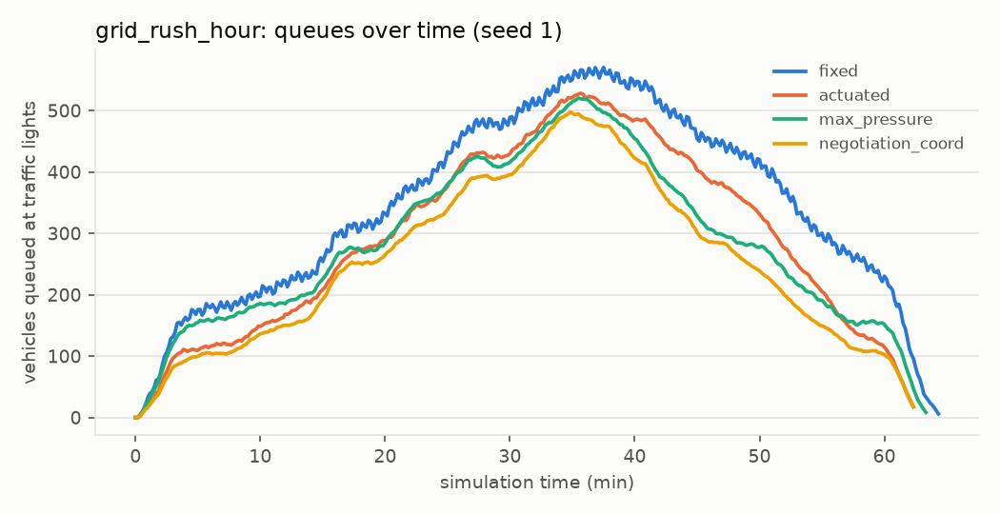
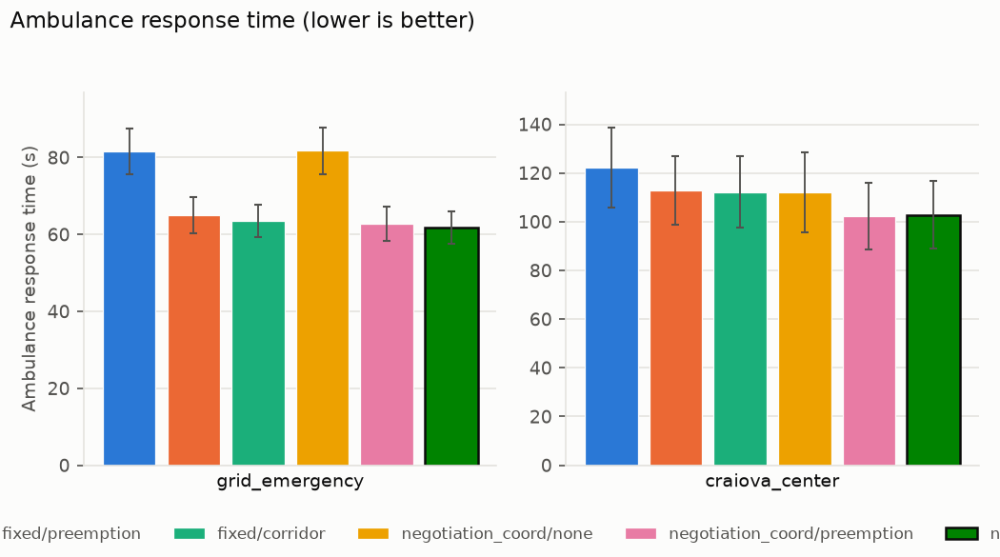
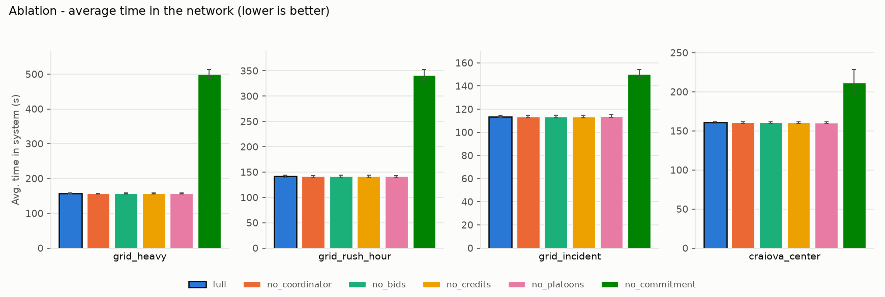
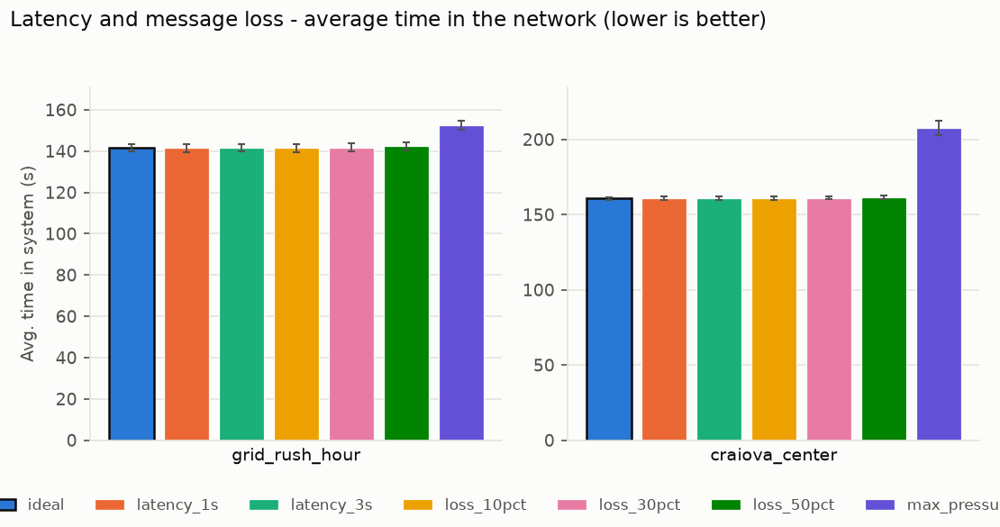
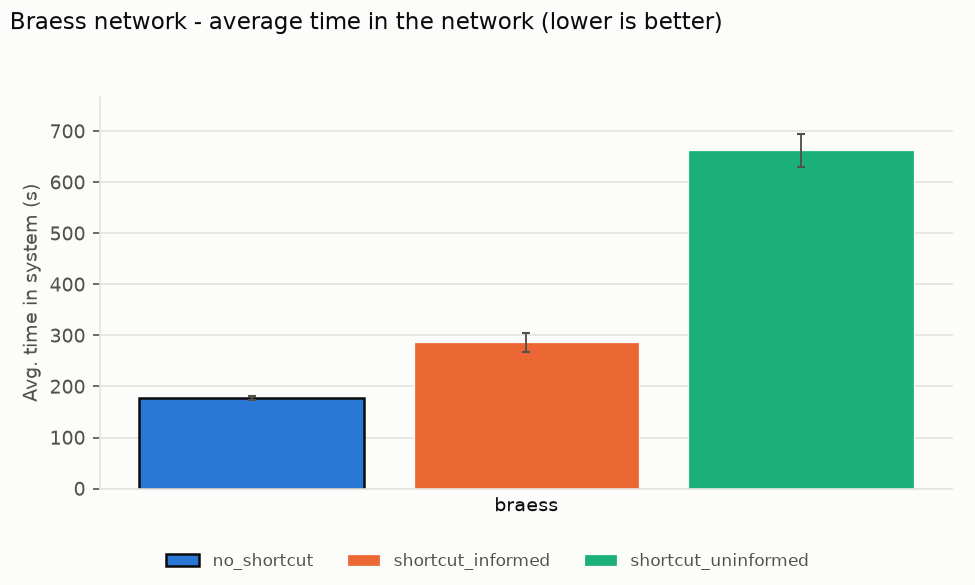
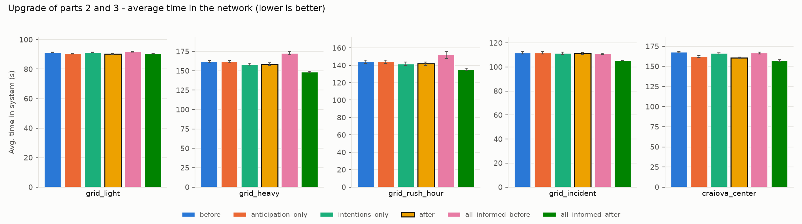
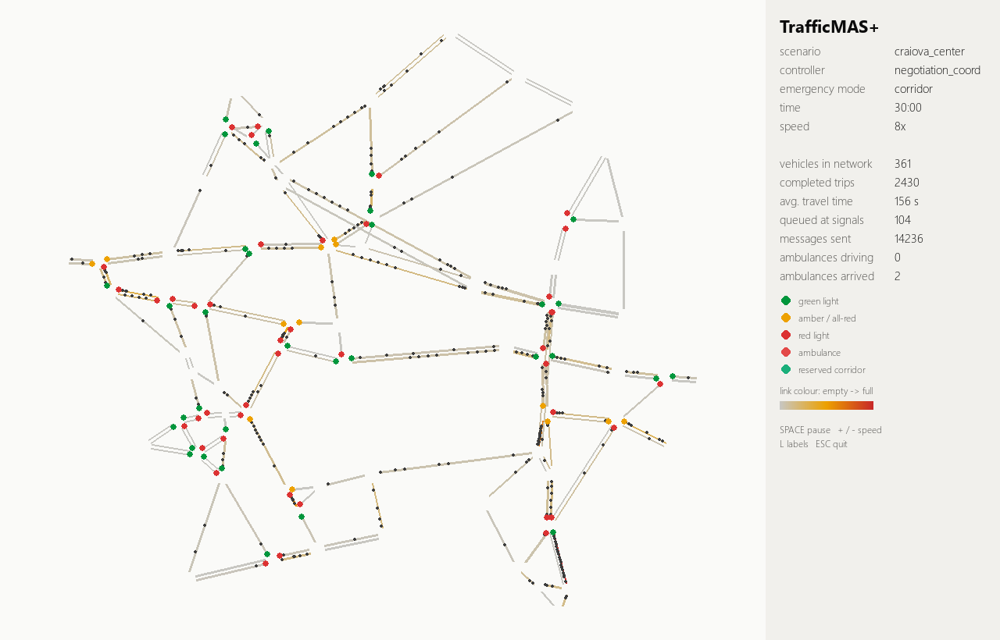

# TrafficMAS+

**Traffic lights that negotiate.** In this multi-agent traffic simulator every intersection is an autonomous agent. It controls its own lights and negotiates green time with its neighbours, so congestion does not spread from one junction to the next. Ambulances reserve a corridor of green lights ahead of them.

The project is written entirely in Python (SimPy, OSMnx/NetworkX for the map import, Pygame, Matplotlib, SciPy). It was built for the **Multi-Agent Systems** course (Master, year 2) by the team **GreenWave Agents**.



| | Member | Role | Branch |
|---|---|---|---|
| 1 | IANCOVICI TEODOR-GABRIEL | Simulation Core & Network Architect | `part1-iancovici` |
| 2 | PRODAN CONSTANTIN-IUSTIN | Intersection Control & Negotiation | `part2-prodan` |
| 3 | GHEORGHEVICI MIHAI | Vehicles, Routing & Emergency | `part3-gheorghevici` |
| 4 | DOBRA ROBERT-CRISTIAN | Evaluation, Visualization & Experiments | `part4-dobra` |

Each member owns the code of their part and works on their own branch. [TEAM.md](TEAM.md) lists which files belong to whom and explains the workflow; CI checks that nobody changes someone else's part.

The project plan is in [docs/TrafficMAS_Planul_Proiectului.pdf](docs/TrafficMAS_Planul_Proiectului.pdf), in Romanian.

## Results

About 1270 simulations, 10 seeds per configuration, each simulating one hour of traffic plus the time the network needs to empty. Numbers are means; the full tables with 95% confidence intervals and the tests are in `results/<experiment>/summary.md`. Every comparison uses a two-sided Mann-Whitney test with Holm correction; "significant" means p < 0.01.

### 1. Negotiation against the classic controllers

Average time a vehicle spends in the network, in seconds (the queue at the gateway included):

| scenario | fixed-time | actuated | max-pressure | **negotiation + coordinator** | vs. best baseline |
|---|---:|---:|---:|---:|---:|
| grid, off-peak | 123.1 | 92.7 | 113.4 | **90.5** | −2.4% (significant) |
| grid, saturated | 173.5 | 167.0 | 163.5 | **156.5** | −4.3% (significant) |
| grid, morning rush hour | 169.2 | 151.1 | 152.7 | **141.6** | −6.2% (significant) |
| grid, accident + closed street | 143.3 | 124.7 | 131.0 | **113.5** | −8.9% (significant) |
| Craiova city centre | 322.7 | 165.1 | 207.9 | **160.7** | −2.7% (significant) |



**Spillback**, measured as the time links spend completely full, almost disappears:

| scenario | fixed-time | actuated | max-pressure | negotiation + coordinator |
|---|---:|---:|---:|---:|
| grid, rush hour | 978 | 419 | 45 | **0** |
| grid, accident | 974 | 868 | 13 | **0** |
| Craiova | 12048 | 491 | 2697 | **21** |

In Craiova, actuated control comes within 3% of negotiation on average, but it lets links stay completely full about 23 times longer.



The queues over the morning rush hour show the same picture: negotiation drains the peak fastest.



**What it costs.** With negotiation the system exchanges 7 to 21 messages per agent per minute, against 7 to 15 with the classic controllers. The messages that every controller shares are the status reports, the congestion broadcasts and the route announcements of the drivers; the difference is the platoon notices and the bids.

**Fairness** (Jain index of the waiting times per approach) is clearly better on the saturated grid: 0.78 against at most 0.71 for the baselines. It is about the same off-peak (0.95 vs. 0.96) and lower in the accident scenario (0.65 vs. 0.71 for max-pressure). The reason is that negotiation serves the busiest approaches first.

### 2. Ambulances

| | grid: response time (s) | grid: delay vs. free flow (s) | Craiova: response (s) | Craiova: delay (s) |
|---|---:|---:|---:|---:|
| negotiation, no priority | 81.7 | 24.7 | 112.1 | 18.3 |
| negotiation, local pre-emption | 62.8 | 5.8 | 102.2 | 8.0 |
| **negotiation, reserved corridor** | **61.8** | **4.7** | **102.8** | **8.8** |
| fixed-time, reserved corridor | 63.5 | 4.8 | 112.1 | 12.9 |

With a corridor, an ambulance loses 81% less time on the grid than without priority, and 52% less in Craiova. The reserved corridor and local pre-emption perform the same: the corridor is slightly ahead on the grid and slightly behind in Craiova, and neither difference is significant.

The clearer effect is on the **other vehicles**. Each run with ambulances is paired with the same run without them. Under fixed-time control, every ambulance with priority costs the rest of the traffic 5000–5500 vehicle-seconds on the grid. Under negotiation it costs 500–760, about 7 to 10 times less, because the agents empty the queues that the ambulance left behind instead of going back to a fixed cycle. In Craiova the picture is noisier. Under negotiation the cost of an ambulance to the others cannot be told from zero (between −130 and +210 vehicle-seconds, with confidence intervals of about ±500). Under fixed-time control, priority even *lowers* the total delay (by 3700–6400 vehicle-seconds), because interrupting the badly congested fixed cycle acts like a little adaptive control.

In the conflict scenario, two ambulances reach junction n1_2 at the same moment. The one with the higher priority keeps its slot; the other is refused and re-plans its route.



### 3. Ablation: what each mechanism contributes

| removed mechanism | grid saturated | grid rush hour | grid accident | Craiova |
|---|---:|---:|---:|---:|
| none (full controller) | 156.5 | 141.6 | 113.5 | 160.7 |
| zone coordinator | 156.4 | 141.5 | 113.5 | 160.7 |
| Contract Net bids | 156.6 | 141.6 | 113.5 | 160.7 |
| credits | 156.5 | 141.6 | 113.5 | 160.7 |
| platoon messages | 156.8 | 141.6 | 114.0 | 160.6 |
| **commitment to the current phase** | **500.1** | **341.0** | **150.4** | **211.9** |

The result is unambiguous: **almost all of the gain comes from the BDI commitment** together with the pressure scoring. Without the commitment, the agents reconsider their phase every few seconds and lose a 4 s intergreen each time. Under saturation the grid then collapses into spillback.

The Contract Net, the credits, the coordinator and the platoons change the result by less than 0.5%, and none of these differences is significant. The reason is that they only act when a link is close to full, and the controller already keeps links from filling up: a whole hour of saturated traffic triggers only about 55 accepted bids in the entire network. Raising the bid weight 4–8× changes nothing either.

So in these scenarios the negotiation layer is a safety net that is almost never needed. Section 7 tests it on a network with much shorter links, where spillback cannot be avoided locally.



### 4. Unreliable communication

Even 3 s of message latency or 50% of messages lost cost negotiation at most 0.6% on the rush hour (141.6 → 142.4 s). It still stays well ahead of max-pressure, which needs no messages at all (152.7 s). In Craiova the ambulance arrives just as fast when half the messages are lost (102.8 s and 102.4 s), because a junction's own sensor covers for a reservation that never arrived. The agents degrade gracefully because every one of them can always fall back on its local pressure.



### 5. A selfish junction

Junction n1_1 multiplies all of its bids by 5. Its share of the won bids rises from 39% to 44% with credits and to 45% without them. Waiting times, its own and everybody else's, do not change measurably. This is the same reason as in the ablation: bids almost never decide a phase in these scenarios. So the credit mechanism works as designed (the cheater cannot bid more than it can pay), but these scenarios cannot show that it matters.

### 6. Braess's paradox

| network | avg. time in the network |
|---|---:|
| without the shortcut A→B | 178 s |
| with the shortcut, drivers informed and selfish | 287 s (+61%) |
| with the shortcut, uninformed drivers on the free-flow shortest route | 663 s (+273%) |

Adding a road makes every driver slower. Selfish drivers who follow the congestion information lose less than drivers who all take the nominally shortest route, but both lose a lot compared to the network without the shortcut. This is the price of anarchy of selfish routing.



### 7. Upgrade of parts 2 and 3

The second version of the intersection control (part 2) and of the vehicles and routing (part 3) adds two mechanisms and fixes one bug. `experiments/upgrade.yaml` switches them on one at a time, with 10 seeds; the tables are in [results/upgrade/summary.md](results/upgrade/summary.md).

- **Anticipation at the junctions.** A negotiating junction now also compares what every phase would actually serve per second of green, counting the vehicles that arrive before the queue is cleared.
- **Intention sharing between informed drivers.** A driver who follows the traffic information announces the route it chose, and every route search counts the vehicles already announced for a link. Before this, all informed drivers saw the same congestion report and moved to the same alternative route together.
- **Exact A\* heuristic.** The straight-line heuristic overestimated wherever a link is shorter than the drawn distance between its nodes. On the Braess network 7.7% of the route searches returned a route that was not the fastest one. Equally fast routes are now shared between drivers at random instead of everybody taking the same one.
- **Credits cannot be spent twice.** A junction could offer the same credits to two neighbours at once and pay both. Credits offered in a bid are now held until the answer arrives.

Average time in the network, in seconds:

| scenario | before | anticipation only | intentions only | **after** | change |
|---|---:|---:|---:|---:|---:|
| grid, off-peak | 91.4 | 90.7 | 91.2 | **90.5** | −1.0% (significant) |
| grid, saturated | 159.9 | 159.7 | 156.6 | **156.5** | −2.1% (p = 0.01) |
| grid, morning rush hour | 143.5 | 143.2 | 141.7 | **141.6** | −1.3% (not significant) |
| grid, accident + closed street | 114.2 | 114.1 | 113.9 | **113.5** | −0.5% (not significant) |
| Craiova city centre | 167.6 | 162.3 | 166.1 | **160.7** | −4.1% (significant) |

The two mechanisms help in different places. Anticipation matters on the real network, where the junctions are irregular and the queues short; intention sharing matters on the saturated grid, where there are parallel routes to spread over.

Only about half of the drivers follow the traffic information in these scenarios, which limits what routing can do. The same comparison for a fleet in which **every driver is informed** shows the full effect:

| scenario | all informed, before | all informed, **after** | change |
|---|---:|---:|---:|
| grid, saturated | 171.6 | **148.6** | −13.4% (significant) |
| grid, morning rush hour | 152.1 | **135.1** | −11.2% (significant) |
| grid, accident + closed street | 110.9 | **105.6** | −4.8% (significant) |
| Craiova city centre | 166.7 | **157.6** | −5.5% (significant) |

Without intention sharing, informing everybody made the saturated grid *slower* than the mixed fleet (171.6 s against 159.9 s): the drivers herd. With it, a fully informed fleet is the fastest configuration measured.

The price is communication. A route announcement is one message, which adds up to 9 messages per agent per minute: 20.6 instead of 11.8 on the saturated grid, and less than 1 more in Craiova.



**Short blocks.** The ablation above suggested that the negotiation layer would only matter where spillback cannot be avoided locally. `experiments/upgrade_tight.yaml` tests exactly that: the rush-hour grid with 80 m blocks (about 20 vehicles per link) at 14000 veh/h, where links are completely full for 11000 to 16000 link-seconds whatever the controller.

| controller | avg. time in the network (s) |
|---|---:|
| fixed-time | 234.2 |
| actuated | 204.4 |
| max-pressure | 191.8 |
| negotiation, before | 165.7 |
| **negotiation, after** | **156.9** |
| after, without bids | 157.0 |
| after, without the coordinator | 155.2 |

Negotiation is significantly faster than all three classic controllers here (18% faster than max-pressure). The upgraded controller is 5.3% faster than the old one, but the run-to-run spread is large and that difference is not significant. The hypothesis itself is not confirmed: even in this regime the bids change nothing, and the coordinator's directives do not help. The junction at the end of a full link can see that the link is full by itself, so a bid from its neighbour tells it nothing new. What neighbours can usefully exchange is information the other one cannot observe, which is what the route announcements of the vehicles do.

### 8. Simulation speed

A second pass over parts 2 and 3 made the simulator faster without changing a single result: all 82 scenario × controller × seed runs of the regression snapshot give the same numbers, to the last bit, as before. Every table above is therefore still valid. CPU time saved per run, against the previous version:

| scenario | fixed-time | actuated | max-pressure | negotiation |
|---|---:|---:|---:|---:|
| grid, light | 17% | 18% | 14% | 21% |
| grid, rush hour | 19% | 17% | 32% | 26% |
| grid, saturated | 14% | 47% | 14% | 22% |
| Craiova | 25% | 25% | 30% | 15% |

About 20% over all sixteen configurations. Where the changes come from:

- **Routing.** The A\* search reads the successors of a link from a cache built once per destination and computes the link costs inline, with the same floating-point operations as before. A re-plan is only worth it if the new route is clearly faster (see the driver profiles below), so the search stops as soon as no route can be fast enough, and is skipped altogether when even the free-flow time from here is too slow.
- **Fewer simulation events.** When a vehicle crosses a junction, the crossing directly schedules its arrival at the next stop line: one SimPy event per link instead of two.
- **Intersections and controllers.** The per-phase data the controllers read every second is prepared once. Within one decision, max-pressure and negotiation compute the queue of each downstream link only once, and the actuated controller looks at the current phase first.

A further pass saved another 11.5% of CPU time over the same sixteen runs (fastest of 11 runs each, measured one at a time), again with all 220 runs of the snapshot (110 configurations × 2 seeds) identical to the last bit:

| scenario | fixed-time | actuated | max-pressure | negotiation |
|---|---:|---:|---:|---:|
| grid, light | 8% | 7% | 17% | 13% |
| grid, rush hour | 12% | 11% | 10% | 13% |
| grid, saturated | 13% | 15% | 13% | 10% |
| Craiova | 10% | 3% | 9% | 17% |

- **Routing.** The heap key `round(f, 6)` is computed with an exact equivalent that avoids the decimal conversion of `round()`, and a bounded re-planning search no longer stores entries beyond its limit.
- **Junctions.** A junction with nothing queued skips its discharge loop once its credits are zero, and the negotiating controller does not compute the service rates that cannot change its decision.

The snapshot and the timing are reproducible with `scripts/benchmark.py`:

```bash
.venv/Scripts/python scripts/benchmark.py snapshot before.json            # every experiment configuration
.venv/Scripts/python scripts/benchmark.py snapshot after.json --compare before.json
.venv/Scripts/python scripts/benchmark.py time --repeat 3                 # the 16 runs above, one at a time
```

### The Craiova network in the live view



## Quick start

```bash
python -m venv .venv
.venv/Scripts/python -m pip install -e .[osm,dev]       # Linux/macOS: .venv/bin/python
.venv/Scripts/python -m trafficmas run scenarios/grid_rush_hour.yaml --controller negotiation_coord --live
```

Python 3.11 or newer is required. The live view uses `pygame-ce`, the maintained fork of Pygame, which has wheels for current Python versions.

| command | what it does |
|---|---|
| `python -m trafficmas run <scenario> -c <controller> [--live]` | one simulation; prints the metrics, `--live` opens the Pygame view |
| `python -m trafficmas compare <scenario> --seeds 3` | every controller on one scenario, averaged over seeds |
| `python -m trafficmas experiment experiments/main.yaml --docs docs` | a full experiment in parallel processes, then statistics and figures |
| `python -m trafficmas analyze results/main` | statistics and figures again from the saved runs |
| `python -m trafficmas list` | controllers, scenarios and experiments |
| `bash scripts/run_all_experiments.sh` | every experiment in this README: about 900 simulations, 10 minutes on 16 cores |

Options of `run`:
- `-p key=value` sets a controller parameter, e.g. `-p credits=false`;
- `-s key.path=value` overrides any scenario field, e.g. `-s demand.rate=9000` or `-s bus.loss=0.3`;
- `--record docs/demo.gif` saves the live view as a GIF without opening a window.

In the live view, `SPACE` pauses, `+`/`-` change the speed, `L` shows the node names and `ESC` quits.

**In VS Code**, open the folder and pick the `.venv` interpreter. The *Run and Debug* panel then has ready-made configurations: live view of the rush hour, the ambulance corridors and the Craiova network, comparing all controllers, the main experiment, and the tests. *Terminal → Run Task* has the same plus install, lint, all experiments, recording the GIF and re-downloading the OSM network.

## How the simulation works

```
          ┌──────────── Experiment runner: scenario × variant × seed, multiprocessing ────────────┐
          │                                                                                       │
 ┌────────▼────────┐     ┌──────────────────┐      ┌──────────────────────────────────────────┐
 │ SimPy engine    │◄───►│ Message bus      │◄────►│ IntersectionAgent  (one per junction)    │
 │ clock, demand,  │     │ latency, loss,   │      │ CoordinatorAgent   (one per zone)        │
 │ incidents       │     │ message counts   │      │ VehicleAgent / EmergencyVehicleAgent     │
 └────────┬────────┘     └──────────────────┘      └──────────────────────────────────────────┘
          │
 ┌────────▼────────┐     ┌──────────────────┐      ┌──────────────────┐
 │ Road network    │────►│ Metrics          │─────►│ Pygame live view │
 │ grid / OSM /    │     │ collector        │      │ Matplotlib plots │
 │ Braess          │     └──────────────────┘      └──────────────────┘
 └─────────────────┘
```

**Traffic model (mesoscopic).** A vehicle crosses a link at free-flow speed and joins a queue at the stop line. Each outgoing movement (left, through, right) has its own queue. A green movement discharges at saturation flow: 1800 veh/h per lane, shared by the lanes of the link. It can only do so while the downstream link has room left: a link holds `length × lanes / 7.5 m` vehicles. A full link blocks the junction behind it, which is how **spillback** spreads through a network. Every phase change costs a 4 s intergreen (amber + all-red). Vehicles from several approaches that merge into the same link are served first come, first served.

**Networks.**
- A parametric grid with arterial roads that have more lanes and a higher speed limit.
- The real centre of **Craiova**, around the University of Craiova, imported from OpenStreetMap with `scripts/fetch_osm.py`. It has 70 junctions, 154 links and 28.1 km of main roads (Calea Unirii, Bulevardul Carol I, Strada Alexandru Ioan Cuza, Pasajul Universității and others), with 53 junctions with traffic lights and 17 gateways on the border of the area.
- The classic **Braess** network.

**Demand.** Poisson arrivals between gateways, with a constant or rush-hour profile and an origin–destination matrix that can be biased (e.g. west→east in the morning). The demand of a seed is identical for every controller, so the controllers are compared on exactly the same traffic.

**Scenarios** (`scenarios/*.yaml`):

| scenario | network | traffic |
|---|---|---|
| `grid_light` | 4×4 grid | 6000 veh/h, off-peak |
| `grid_heavy` | 4×4 grid | 18000 veh/h, saturated |
| `grid_rush_hour` | 4×4 grid | 13000 veh/h at the peak, mostly west→east and south→north |
| `grid_incident` | 4×4 grid | 11000 veh/h; an accident blocks 75% of an arterial for 25 min and a side street is closed |
| `grid_emergency` | 4×4 grid | 14000 veh/h; 10 ambulances, two of them crossing at the same junction at the same time |
| `craiova_center` | Craiova city centre, OpenStreetMap | 5500 veh/h at the peak, 4 ambulances |
| `braess` | Braess network | 1600 veh/h from S to E, with or without the shortcut |

## The agents

The four agent types behave differently along the four properties of an agent (Wooldridge):

| agent | autonomy | reactivity | proactivity | social ability |
|---|---|---|---|---|
| **IntersectionAgent** | chooses its own phases | reacts to its queues, corridor requests and coordinator directives | bids for green downstream before its exits fill up; announces platoons | Contract Net with its neighbours, status reports to the coordinator |
| **VehicleAgent** | chooses its own route | re-plans on congestion broadcasts and closures | pursues its destination | listens to the coordinators' broadcasts, announces its route to the other drivers |
| **EmergencyVehicleAgent** | plans its corridor | re-plans around a junction that refuses it | reserves junctions before it reaches them | FIPA Request for every slot, ETA updates, release |
| **CoordinatorAgent** | decides its zone's strategy | detects spillback | broadcasts congestion estimates | collects status, sends drain and meter directives |

Messages use FIPA-ACL performatives (`CFP`, `PROPOSE`, `ACCEPT`, `REJECT`, `REQUEST`, `INFORM`) and go over a bus that can delay and lose them. Every delivery is counted, which gives the communication cost of each controller. The shared interfaces of the four parts are in [`trafficmas/contracts.py`](trafficmas/contracts.py).

### The negotiating intersection (the original part)

[`control/negotiation.py`](trafficmas/control/negotiation.py) runs a simplified **BDI** loop:

- **Beliefs**: its own queues, how full the downstream links are, the bids of the current round, platoon notices from upstream and directives from the coordinator.
- **Desires**: low pressure, no spillback into the neighbours, serving the platoons that arrive.
- **Intention**: the current green phase. When a phase turns green the agent **commits** to it until the queue it found is served (at most 40 s). After that it switches only when another phase scores clearly better (hysteresis). Every switch costs an intergreen, so an agent that keeps reconsidering loses capacity exactly when traffic is heaviest. Without the commitment, the controller collapses under saturation (see the ablation).

Each phase gets a **score**:
- the max-pressure weight of its movements: queue minus the average queue downstream, zero into a full link;
- plus the vehicles about to arrive;
- plus the bids of the upstream neighbours;
- plus the platoons announced to it;
- plus or minus the coordinator's directives.

**Anticipation.** Pressure compares queues, which says little when queues are short. Once its commitment is over, the agent therefore also compares what every phase would actually *serve*: its queue plus the vehicles that reach the stop line before that queue is cleared, per second of green, with the 4 s intergreen charged to the phases that are not green yet (the priority index of Lämmer and Helbing, 2008). It switches when another phase would serve at least 20% more per second. A phase that is discharging at saturation flow always wins this comparison, so the rule only acts when the current green is running thin.

**Contract Net for green time.** Each agent is the manager of its own green time and a contractor for its downstream neighbours:

```
 upstream U (contractor)                          downstream N (manager)
        │   ◄────────── CFP (round r, link U→N) ──────────   │  only to neighbours whose link into N is > 50% full
        │   urgency = vehicles waiting at U to enter U→N     │
        │             × how full U→N is                      │
        │   ─────────── PROPOSE (value ≤ credits) ────────►  │  silent if not urgent (saves messages)
        │                                                    │  score(phase) += 0.4 × bids for its links
        │   ◄──── ACCEPT (pay value) / REJECT ─────────────  │  settled when the phase is decided
```

**Credits.** An accepted bid is paid with credits. Credits regenerate at 0.25 per second, up to 80, and credits offered in a bid are held until it is answered. A junction that inflates its bids runs out of credits and cannot dominate its neighbours for long (see the manipulation test).

**Platoons.** When a green ends, the agent tells each signalised downstream neighbour how many vehicles it just released and when they will arrive. The neighbour adds them to the score of the phase that serves them. Green waves then emerge from local messages alone, without any central offset plan.

**Coordinator directives.** When a link is more than 85% full, the zone coordinator asks the junction at its end to drain it and the junction feeding it to hold traffic back (meter), for 30 s.

### Ambulances

Three modes are compared:
- `none`: no priority. The ambulance moves to the head of the queue, because cars pull aside, but waits for green. At a red light it crosses carefully after 8 s.
- `preemption`: classic local pre-emption. A junction switches to the ambulance's phase as soon as the ambulance is on its approach.
- `corridor`: at departure the ambulance sends a FIPA `REQUEST` for a time slot to every signalised junction on its route, with its ETA there.
  - Each junction starts the green early enough to empty the approach: an intergreen, plus the time to clear the queue, plus a margin.
  - On a crowded link the ambulance is slowed down by up to 2.5×, because cars have to get out of its way. So an empty approach pays off.
  - ETAs are refreshed while driving, and a slot is released as soon as the ambulance has crossed.
  - Two requests that need different phases at the same time are settled by priority: a higher priority displaces a lower one, which is told so and tries to re-plan around that junction.
  - If a reservation is never confirmed because messages were lost, the junction's own sensor still detects the ambulance on the approach, as in `preemption`. With half of the messages lost and 3 s of latency, a corridor then costs the ambulance no more time than with a perfect radio.

### Vehicles

Vehicles route with a **time-dependent A\*** over links, so turn restrictions are respected. A link costs its free-flow time plus the delay expected at its stop line, which has two parts:
- the queueing delay last broadcast by the coordinators. It fades out over a horizon (10 min by default), since a queue seen now matters less to a vehicle that will arrive there much later;
- the time to serve the vehicles that have **announced** the same link for the same 30 s slot and are expected to arrive first (half of them, on average).

The heuristic is the exact free-flow time from every link to the destination, computed once per destination by a reverse Dijkstra. It never overestimates, whatever the geometry of the network, and without congestion the search walks straight down the best route.

**Intention sharing.** An informed driver sends its planned route to the information board (one `INFORM` message) when it departs and whenever it changes route, and withdraws it when it arrives. `routing.intentions: false` in a scenario turns this off.

There are three driver profiles: conservative, normal and aggressive. A driver follows the advice with probability 0.2 / 0.5 / 0.9 and switches route for a gain of at least 30% / 15% / 5%. Drivers who do not follow the advice take their usual free-flow route.

Because of that minimum gain, a re-plan only has to find a route that beats the current one by it. The search gives up as soon as its lower bound on the arrival time rules that out, which skips most of the work of re-planning without changing its outcome.

## Tests

```bash
.venv/Scripts/python -m pytest -q        # 192 tests, under a minute
.venv/Scripts/ruff check trafficmas tests scripts
```

The unit tests cover the network builders, the bus, every controller, the Contract Net round with payment, corridor conflicts, demand and scenario validation.

The harder tests run whole simulations and check properties that must hold at every step:
- **Routing against an exhaustive search.** A\* is compared with a plain Dijkstra on 480 random queries over random networks, with random delays, closures and start times; the heuristic is checked to be the exact free-flow time on every shipped network.
- **Signal timing.** For every controller on a saturated grid: the intergreen always lasts exactly 4 s and leads to a different phase, and no green is shorter than the controller's minimum.
- **No starvation.** Under negotiation no waiting phase stays red longer than the guard allows.
- **Contract Net, message by message.** Every bid answers a call for proposals, there is one bid per round, every answer comes from the manager of the round, an accepted bid is paid exactly once, and credits never leave the range [0, cap]. A cheating junction never spends more than it earns (this test found that credits could be offered twice).
- **Coordinator.** Directives are only sent with gating enabled and never repeated before they expire.
- **Ambulances.** No junction stays held for an ambulance that has passed or changed route, no reservation is left at the end, also with 3 s of latency and half of the messages lost; a corridor over that radio still beats no priority.
- **Intention sharing.** With every driver informed it must shorten the trips by at least 5%; all announced plans are withdrawn when the trips end.
- **Invariants on random configurations** (`tests/test_invariants.py`): nothing is served on red, saturation flow and link storage are respected, and no vehicle is lost or duplicated.
- Scenarios that name unknown links or nodes fail at start with a clear error.
- **Detours and closed roads.** A refused ambulance re-plans around the junction when the detour is at most 30% slower, frees the slots it no longer needs and requests the new corridor; a vehicle facing a closed road with no alternative waits for it to reopen.
- **The speed-ups stay exact.** A bounded search returns the unbounded answer or nothing, the reported arrival is the route's cost bit for bit, the fast rounding equals `round()`, and A\* pops at most 70% of the heap entries of a plain Dijkstra.

CI (GitHub Actions) runs the tests and the linter on Linux and Windows, plus a short experiment and a headless recording of the live view.

Beyond the unit tests, the simulator was checked with 250 random configurations: every controller, network and ambulance mode, grid sizes, message latency and loss. During those runs it was checked continuously that no vehicle is served on red (ambulances excepted), no link holds more vehicles than it has room for, no approach discharges faster than its saturation flow, and every vehicle is in exactly one place and is never lost.

## Project layout

```
trafficmas/
  contracts.py            messages, agent and controller interfaces shared by the four parts
  sim/  engine.py demand.py                         (1) SimPy world, demand, incidents
  network/  road.py grid.py osm.py braess.py        (1) queue model and network builders
  bus/  bus.py                                      (1) message bus with latency and loss
  agents/  intersection.py coordinator.py           (2) signal agents and zone coordinators
  control/  classic.py negotiation.py               (2) fixed, actuated, max-pressure, negotiation
  agents/  vehicle.py emergency.py                  (3) drivers and ambulances
  routing/  router.py                               (3) time-dependent A*, congestion board
  metrics/  collector.py                            (4) trip records, samples, CO2, fairness
  viz/  live.py plots.py                            (4) Pygame view, figures
  experiments/  runner.py analysis.py               (4) parallel runs, statistics
scenarios/        YAML scenarios
experiments/      YAML experiment definitions
results/<name>/   runs.csv (one row per run) and summary.md (tables and tests)
data/             Craiova road network exported from OpenStreetMap (© OpenStreetMap contributors, ODbL)
scripts/          fetch_osm.py, run_all_experiments.sh
docs/             figures, demo GIF, project plan
```

## Limitations

- The traffic model is mesoscopic, not microscopic. There is no car following or lane changing, and a queue's length counts vehicles, not metres of road. This keeps a one-hour simulation of a city district at a few seconds, which made the roughly 900 runs of the experiments possible.
- Left turns do not yield to oncoming traffic, there are no pedestrians, and right turns on red are not allowed.
- CO2 is a simple estimate (150 g/km driving, 0.5 g/s idling, 10 g per stop), meant only to compare controllers with each other.
- The baselines were tuned on the grid with two seeds outside the evaluation seeds:
  - fixed-time: 30 s greens;
  - actuated: 8–30 s greens with a 3 s gap;
  - max-pressure: a decision every 20 s, which was much better than 8 s under saturation.
  The negotiation parameters were tuned the same way.
- Route announcements are counted in whole 30 s slots, and the search assumes that leaving later never gets a vehicle there earlier. With announcements this is only approximately true, so a route can occasionally be a few seconds off the optimum.
- The upgrade of parts 2 and 3 was tuned on seeds outside the evaluation seeds, like the baselines.
- The optional reinforcement-learning baseline from the plan was not implemented.
